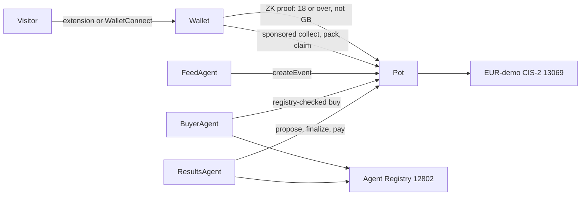

# EventScope

Collect cards on real events. Winning cards pay out. Concordium testnet only; EUR-demo is play money, not redeemable; no house fee.

**Live:** <https://eventscope-lwpm.onrender.com>
**Code:** <https://github.com/henry-n41/eventscope>
**Path to mainnet:** [docs/GO-LIVE.md](docs/GO-LIVE.md)
**Hackathon submission text:** [docs/SUBMISSION.md](docs/SUBMISSION.md)

## What it is

- **Live drops.** A feed agent pulls real fixtures, prices and weather from free public sources (ESPN public scoreboards, Coinbase Exchange candles, MET Norway) and creates each event on chain. Nothing is typed by hand.
- **Cards.** Every outcome is a collectible card with generated art. Serial #001 is Legendary, #002 to #003 Epic, #004 to #010 Rare, then Common. A pack is 3 random cards in one all-or-nothing transaction.
- **Your own wallet.** Connect Concordium Wallet for Web, or a Concordium mobile wallet through WalletConnect, prove you are 18 or over and not resident in the United Kingdom with a zero-knowledge proof (nothing else is revealed), get €20 EUR-demo once, collect cards and packs, see your collection, and get paid automatically. EventScope pays the network fees (sponsored transactions).
- **Your own buyer agent.** Register an AI agent in Concordium's Agent Registry (CIS-8004, contract [12802,0](https://ccdexplorer.io/testnet/smart-contract/12802/0)) under your account, fund it, set your daily cap or pause yourself. The prize pot reads the registry on chain at every agent buy, credits the cards to you and enforces your limits; going over the cap needs your own signed approval.
- **Results agent.** A registered agent posts each result with the SHA-256 of the exact source response, a short dispute window follows (3 minutes on this demo), then the result is final and prizes are paid automatically. Download any evidence file and hash it yourself.
- **Demo people** (Amy, Cal, Ben) use test keys held by the server, for a quick look without a wallet. Clearly labelled.

## Concordium pieces on testnet

| Piece | Where |
|---|---|
| Prize pot | [13076,0](https://ccdexplorer.io/testnet/smart-contract/13076/0) (`contracts/eventscope`) |
| EUR-demo CIS-2 token | [13069,0](https://ccdexplorer.io/testnet/smart-contract/13069/0) (`contracts/eurdemo`) |
| Agent Registry | [12802,0](https://ccdexplorer.io/testnet/smart-contract/12802/0) |
| Buyer agent | [#1295](https://eventscope-lwpm.onrender.com/agents/1295.json) (Amy) |
| Results agent | [#1296](https://eventscope-lwpm.onrender.com/agents/1296.json) (operator) |
| Visitor-registered agent (example) | #1306 |
| Operator (pays fees) | [3N9s8YUN…Ye6fn](https://ccdexplorer.io/testnet/account/3N9s8YUN2pxMuP5bszXUUk9vZ3ks7tDgxgzhG5arGr5qGYe6fn) |

`contracts/mockregistry` is a test-only stand-in for the registry. It was never deployed.

A complete payout cycle (event #380, Barcelona 3–2 Villarreal, 22 November 2026): [result](https://ccdexplorer.io/testnet/transaction/6f4637d6d45a2701bab35dbad5ce9fc96b4ba9a47ce840f7dfd699e7b3088fcc), [finalize](https://ccdexplorer.io/testnet/transaction/bad83a90279f920ba6e2660f08092a037877dd65d6c56b765d3412cc18a2586a), [€6.00 paid to Amy](https://ccdexplorer.io/testnet/transaction/cd367157b034216973586a6f1af753cb9887dc1bb0be641cc9bb83693e85659b).

## Architecture

The page talks to a Node server. The server prepares sponsored transactions (the operator signs the fee; the wallet signs the action), anchors proof requests, and runs the feed and results agents on timers. The pot is the source of truth for events, allow flags, caps and payouts. The server keeps an off-chain index (titles, art, evidence files) in a durable store.

## Play as yourself (Concordium Wallet for Web, testnet)

1. Install **Concordium Wallet** for Chrome from the Chrome Web Store and create a wallet. Keep your recovery phrase to yourself.
2. Switch the wallet's network to **Testnet**.
3. Request a **test identity** from one of the testnet identity providers. Enter a date of birth that makes you 18 or over and a country of residence other than the United Kingdom (for example Germany).
4. Create an **account** with that identity. You do not need CCD: EventScope pays the network fees.
5. Open the site, click **Connect wallet**, approve the connection in the wallet.
6. Click **Verify age 18+** and approve the proof request in the wallet. You get €20 EUR-demo play money (once per account).
7. Collect a card (**Collect · €2**) or open a pack, approve each transaction in the wallet. Your cards are under **My collection**.
8. Optional: **My agent** → **Create my agent** (up to 3 wallet approvals), **Move €6 to my agent**, **Let my agent pick 3 cards**. Set your daily cap or pause yourself on the same page.

## Play from your phone (Concordium mobile wallet, WalletConnect)

Works with **CryptoX** or **Concordium Wallet** for mobile, set to Testnet, with a test identity and account (steps 2 to 4 above, done in the phone app).

- **On the phone:** open the site in the phone browser, tap **Phone wallet** (or **Connect wallet**), pick your wallet app, approve the connection there, then come back to the browser. For each proof or transaction the site says "approve in your phone wallet"; switch to the wallet app, approve, switch back. If the app does not open by itself, use the links in the on-screen message.
- **On a computer without the extension:** click **Phone wallet** and scan the QR code with the wallet app.

The same sponsored transactions and the same 18-or-over, not-United-Kingdom proof are used as with the extension. This uses Concordium's `@concordium/wallet-connectors` (WalletConnect v2, chain `ccd:testnet`). **Add EUR-demo to wallet** is extension-only; in a mobile wallet add the token by hand (contract index 13069, subindex 0).

The phone layout is a single column of drops, a scrollable menu, and buttons sized for a finger. A real-phone walkthrough (opening the wallet app and producing the proof there) still needs a person with the app installed; the relay path was tested with a simulated wallet.

## How to run

    cargo test                                # contract tests
    node tests/guard_test.mjs                 # rate limits and sponsor budget
    CCD_SPONSOR_PRIVATE_KEY=... node server.mjs   # http://127.0.0.1:8100, runs the feed and results agents on timers
    ./build.sh                                # rebuild web/app.js (extension glue) and web/wc.js (phone wallet, loaded on demand)

Secrets come only from the environment, never from the repo.

| Variable | What |
|---|---|
| `CCD_SPONSOR_PRIVATE_KEY` | operator account key: pays fees, runs the feed and results agents |
| `EVENTSCOPE_DEMO_SECRETS_B64` or secret file `/etc/secrets/demo-secrets.b64` | testnet keys of the demo people and the agent-wallet pool (optional) |
| `REDIS_URL` | Render Key Value; keeps the off-chain index (event display data, card serials, evidence) across restarts |
| `EVENTSCOPE_SPONSOR_CCD_PER_HOUR` | hourly cap on CCD spent for visitors (default 750); over it the site says "busy, try later" |
| `EVENTSCOPE_KEEPALIVE` | `1` pings the public URL every 10 minutes so Render's free plan does not put the agents to sleep |
| `EVENTSCOPE_FEED_DAILY` | max new events per rolling 24 h (default 10: 4 crypto slots, 3 cities, up to 3 fixtures) |
| `EVENTSCOPE_WARN_CCD`, `EVENTSCOPE_STOP_FEED_CCD`, `EVENTSCOPE_STOP_ALL_CCD` | operator balance watchdog: warn (2000), stop creating events (1000), stop agent spending (300). Balance and burn per day are in `/api/health` |
| `WALLETCONNECT_PROJECT_ID` | optional Reown (WalletConnect Cloud) project ID for the phone wallet. Unset = Concordium's shared dApp project ID that `@concordium/wallet-connectors` exports for dApps without their own |
| `EVENTSCOPE_RUN_UNTIL` | end date for the projected-spend figure in `/api/health` (default 2026-12-11) |

Deploy: `render.yaml` (Blueprint) or `node scripts/render-deploy.mjs <keyValueId>`.

## Tests

    node tests/wallet_page_test.mjs           # page's real-wallet code path with a stand-in wallet (server running)
    node tests/mobile_ui_test.mjs             # small screens and the WalletConnect modal (desktop, iPhone, Pixel); signs nothing
    node tests/phone_wallet_sim_test.mjs      # a simulated phone wallet pairs over the real relay and approves one Collect
    node tests/extension_regression_test.mjs  # extension path unchanged (stand-in wallet, one Collect)
    node tests/guard_test.mjs                 # rate limits and sponsor budget
    cargo test                                # pot and token contract tests

## Licence

MIT. See [LICENSE](LICENSE).
